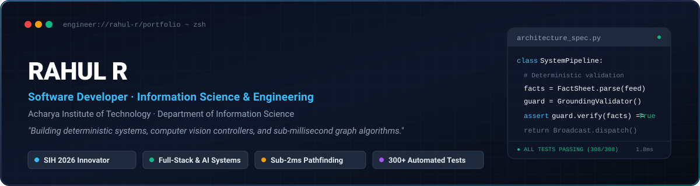

# Rahul R

**Software Developer · Information Science & Engineering Student**  
*Acharya Institute of Technology, Bengaluru*

Building deterministic, low-latency software systems — from disaster-response AI pipelines to computer vision and digital forensics.

---

## 👨‍💻 About Me

<table>
  <tr>
    <td width="220" align="center" valign="middle">
      
    </td>
    <td valign="middle">
      

        I am an Information Science &amp; Engineering student dedicated to building end-to-end software systems rather than surface-level prototypes. My projects range from high-stakes disaster intelligence platforms (Smart India Hackathon 2026) and CCTV forensic video intelligence with low-level FAT16 disk parsing, to real-time event management architectures and sub-millisecond competitive AI bots.
      

      

        I approach engineering with a focus on <b>honesty, traceability, and operational rigor</b>: every critical claim is backed by deterministic verification pipelines, core components are covered by reproducible automated tests, and trade-offs are documented transparently. I also enjoy applied mathematics, particularly in turning complex algorithmic problems into elegant, low-latency routines.
      

    </td>
  </tr>
</table>

 

> ### *"Don't just learn how the world works. Build what makes it better."*

---

## 🛠️ Technical Arsenal

<b>Languages & Core Technologies</b>

 

<b>Backend & Systems Architecture</b>

 

<b>Computer Vision & AI Engineering</b>

 

<b>Databases, DevOps & Environments</b>

 

---

## 🚀 Featured Engineering Projects

### 🌩️ SkySafe AI — Disaster Alert Intelligence Platform
> **Smart India Hackathon 2026** · Problem SIH26068 (Weather + Disaster Management)  
> *Deterministic fact-validation pipeline transforming official CAP 1.2 XML emergency feeds into verified citizen broadcasts.*

* **The Problem:** In critical disaster management, LLM hallucinations can cause fatal consequences (such as inverted wind directions or incorrect evacuation zones). Standard generative models cannot be directly trusted with ungrounded public bulletins.
* **Architecture & Engineering:** Designed an end-to-end zero-hallucination pipeline:
  1. Real CAP 1.2 feeds (NDMA SACHET / IMD) are ingested and deterministically parsed into an immutable `FactSheet` with cryptographic IDs.
  2. The LLM is strictly constrained to rephrasing and summarizing verified facts — never generating new claims.
  3. A `GroundingValidator` audits every numeral, date, severity level, and geographic token against the raw bulletin before broadcast; mismatches trigger automatic retries followed by an LLM-free deterministic template fallback.
* **Key Capabilities:** Offline-capable Citizen Progressive Web App (PWA), multilingual voice/SMS broadcasts via Twilio, and a commander dashboard with heuristic resource allocation.
* **Verification:** **308 automated backend unit & integration tests pass** with zero external API dependencies.
* **Stack:** Python, FastAPI, Next.js, TypeScript, SQLite/PostgreSQL, Docker, Gemini AI, Twilio  
* 🔗 **Repository:** [Rahul-2006ra/SkySafe-AI](https://github.com/Rahul-2006ra/SkySafe-AI)

---

### 🎥 CamTrace Intelligence — Multi-Vendor DVR/NVR Forensic Platform
> **Smart India Hackathon 2026** · Problem SIH26150 · Team Phoenix  
> *Forensic video ingestion, raw filesystem recovery, and semantic search across fragmented surveillance systems.*

* **The Problem:** Forensic investigations encounter video exports across disparate proprietary containers, unsynchronized camera clocks, and deleted or fragmented footage.
* **Architecture & Engineering:** 
  1. Built a low-level FAT16 raw disk directory parser that scans unallocated sectors to reconstruct deleted video records from forensic disk images.
  2. Implemented timestamp normalization with signed clock-skew correction matrices to align multi-camera timelines.
  3. Integrated YOLOv8 object detection, ByteTrack tracking, and CLIP multimodal embeddings into Qdrant for natural-language semantic scene retrieval.
* **Key Capabilities:** Tamper-evident SHA-256 audit chaining for chain of custody, evidence export packaging, and automated courtroom-admissible PDF reporting.
* **Verification:** **39 unit/integration tests** and **3 Playwright end-to-end browser tests** fully passing.
* **Stack:** Python, FastAPI, React, TypeScript, Vite, YOLOv8, CLIP, Qdrant, FFmpeg, SQLite, Playwright  
* 🔗 **Repository:** [Rahul-2006ra/SIH26150-Prototype](https://github.com/Rahul-2006ra/SIH26150-Prototype)

---

### 🎟️ EventSphere — Real-Time AI Event Management Platform
> **Production Deployed Web Application**  
> *High-concurrency ticket reservation, real-time live attendance sync, and fraud-resistant QR validation.*

* **The Problem:** Multi-gate admissions at high-traffic events lead to race conditions, double entry, and organizer dashboard desynchronization.
* **Architecture & Engineering:** 
  1. Architected scoped Socket.IO event rooms enabling sub-second multi-dashboard synchronization without polling overhead.
  2. Integrated Razorpay payment processing with server-side HMAC-SHA256 signature verification to prevent price manipulation and replay attacks.
  3. Dynamic cryptographically signed QR ticket generation with single-use scan validation for immediate admission verification.
* **Key Capabilities:** Live organizer revenue metrics, real-time check-in stream, and a Gemini AI event copy/schedule generator.
* **Stack:** Node.js, Express, Prisma ORM, PostgreSQL, Socket.IO, Python, Flask, Gemini AI, Razorpay  
* 🔗 **Repository:** [Rahul-2006ra/EventSphere](https://github.com/Rahul-2006ra/EventSphere) · 🌐 **Live Demo:** [event-sphere-flame.vercel.app](https://event-sphere-flame.vercel.app)

---

### 🤖 Subway Escape Bot — Competitive Pathfinding AI Bot
> **AI × Maths Hackathon** · Standalone Bot Implementation (`rahulrkudlur.py`)  
> *Autonomous real-time decision-making bot navigating dynamic obstacle fields under strict latency constraints.*

* **The Problem:** Navigating an adversarial 2D grid containing decaying safehouses, contesting opponents, and moving police patrols within a strict 1,000 ms decision window.
* **Architecture & Engineering:** Designed a graph pathfinding engine utilizing a two-leg exponential decay valuation model. The engine dynamically computes route utility by factoring in safehouse payoff degradation, police interception vectors, and opponent collision penalties.
* **Key Metric:** Executes decisions in **~1.8 ms per tick** — utilizing **< 0.2%** of the 1,000 ms hackathon time ceiling.
* **Stack:** Python, NetworkX/Graph Algorithms, Mathematical Optimization  
* 🔗 **Repository:** [Rahul-2006ra/Ravanger-Subway-Escape](https://github.com/Rahul-2006ra/Ravanger-Subway-Escape)

---

### 🖐️ Hand Gesture Controller — Touchless Computer Vision Game Input
> *Real-time webcam gesture recognition for keyboard-controlled arcade games.*

* **The Problem:** Single-frame landmark coordinates suffer from hand jitter and false triggers during fast movements.
* **Architecture & Engineering:** 
  1. Anchors tracking to the palm center (vector mean of wrist and middle metacarpal) rather than noisy fingertips to eliminate false positives.
  2. Processes coordinates through a 0.35s rolling velocity buffer; inputs only trigger when displacement and velocity thresholds are simultaneously met, followed by a 0.45s debounce cooldown.
* **Key Capabilities:** Real-time MediaPipe 21-landmark tracking and DirectInput keystroke injection for games like Temple Run and Subway Surfers.
* **Stack:** Python, OpenCV, MediaPipe, PyDirectInput  
* 🔗 **Repository:** [Rahul-2006ra/Hand-Gesture-Temple-Run-Name](https://github.com/Rahul-2006ra/Hand-Gesture-Temple-Run-Name)

---

## 📂 Additional Notable Work

| Project | Domain | Key Implementation Highlight |
| :--- | :--- | :--- |
| [**No-Due Mini Project**](https://github.com/Rahul-2006ra/No-Due-Mini-Project-) | Full-Stack Academic | Clearance workflow migrated to Firebase Auth + Express + MongoDB |
| [**Smart Disaster Alert**](https://github.com/Rahul-2006ra/Smart-Disaster-Alert-And-Safety-Recomandation) | Web Application | Client-side natural disaster classification with immediate safety protocol guides ([Live Demo](https://rahul-2006ra.github.io/Smart-Disaster-Alert-And-Safety-Recomandation/)) |
| [**10-Number Math Hack**](https://github.com/Rahul-2006ra/10---Numbers-Math-Hack-Trick-) | Applied Mathematics | Mathematical formulation and proof for instant summation of arithmetic sequences |
| [**AI Resume Analyzer**](https://github.com/Rahul-2006ra/AI-Resume-Analyzer) | Developer Tools | ATS keyword density and formatting inspection utility |

---

## 📊 GitHub Analytics

---

## 📬 Connect With Me

| Channel | Contact Point |
| :--- | :--- |
| **LinkedIn** | [linkedin.com/in/rahul-r-737137338](https://www.linkedin.com/in/rahul-r-737137338/) |
| **Email** | [rahulrkudlur@gmail.com](mailto:rahulrkudlur@gmail.com) |
| **GitHub** | [github.com/Rahul-2006ra](https://github.com/Rahul-2006ra) |

---

*“Don't just learn how the world works. Build what makes it better.”*

